<p align="center">
  
</p>

<h1 align="center">JimmyHQ</h1>

<p align="center">
  Bring the model you want. Put it to work on what you need done.
  Open source, on your own computer.
</p>

<p align="center">
  Version <!-- version:start -->0.1.0<!-- version:end --> · early development · Apache-2.0
</p>

JimmyHQ is a local-first platform that runs on your own computer and opens in your browser. It
gives one person a single place for their tasks, their notes and memory, their AI models and
the agents that work for them, and it brings every decision back to you to approve.

It is for someone who wants AI help without handing their life to a hosted service: people
who run models on their own hardware, people who want agents they can watch and stop, and
developers who want a private base to build small apps on. There is one owner per install, and
your data stays in one folder on your machine.

<p align="center">
  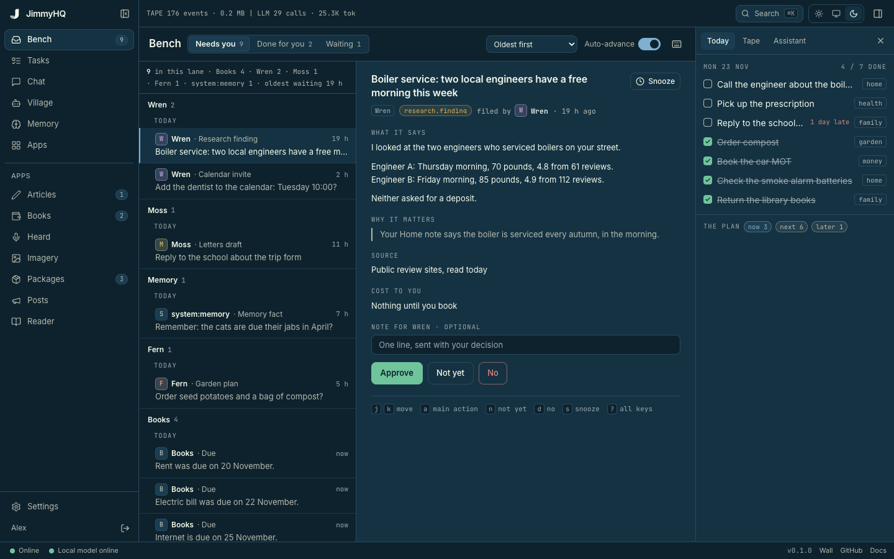
</p>

<sub>Every picture in this README is JimmyHQ running on invented sample data
(see [Screenshots](#screenshots)).</sub>

> **Status: early.** Most areas below run today and have tests, but JimmyHQ is not ready for
> daily use by people who cannot afford surprises. [Project status](#project-status) says what
> is solid and what has not met a real outside service yet.

## Contents

- [Why it exists](#why-it-exists)
- [A tour](#a-tour): [the Tape](#the-tape), [the Bench](#the-bench), [Tasks](#tasks),
  [Chat](#chat-and-the-assistant), [the Village](#the-village), [Memory](#memory),
  [Models](#models), [Voice](#voice), [the Wall](#the-wall), [Backups](#backups),
  [other devices and machines](#reaching-it-from-other-devices-and-machines),
  [the doors](#the-doors)
- [Apps](#apps)
- [Quick start](#quick-start)
- [Configuration](#configuration)
- [Security model](#security-model)
- [Privacy](#privacy)
- [Architecture in brief](#architecture-in-brief)
- [Building an app](#building-an-app)
- [Development](#development)
- [Project status](#project-status) and [roadmap](#roadmap)
- [Contributing](#contributing) and [licence](#licence)

## Why it exists

- **Local first.** Work goes to a model on your own machine by default. A hosted model is used
  only when you put one in a role or pick it by name, and the screen says when one is in use.
- **Your data stays yours.** Everything is in one folder on your computer, outside the source
  tree. There is no account with us, and nothing is sent to us (see [Privacy](#privacy)).
- **One owner.** JimmyHQ is built for one person. Agents and apps act as themselves, never as
  you, and only your own click records a decision.
- **Agents bring decisions to you.** Sending, posting, paying and deleting wait for your
  approval unless you have allowed that one action. What an agent found or drafted lands on
  the Bench, and "empty" means done.
- **Nothing is hidden.** Every decision and action is appended to a record you can read, the
  Tape. Every screen is a view over it.
- **Everything is a setting.** Models, schedules, layout and sources are yours to change, from
  the screen, from a file or from the command line.

## A tour

### The Tape

An append-only record of every decision and action: who did what, when, and what caused it.
Each event has a typed kind, an actor and lineage (what led to it). Nothing is rewritten. The
one exception is erasure you ask for, which keeps the event's place and removes what it said.
Screens read stored views over the Tape (called lenses), not the Tape itself, so they stay
fast. The side panel shows it live.

<p align="center">
  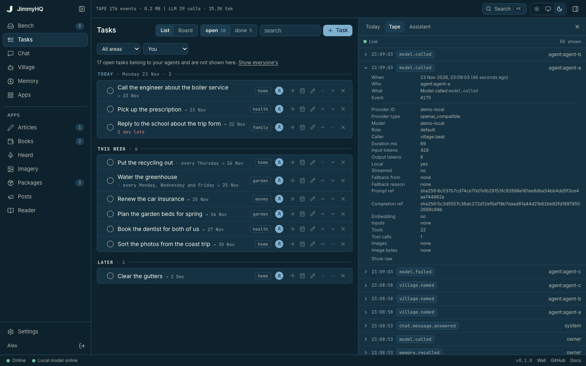
</p>

More: [Architecture, The Tape](docs/architecture.md#the-tape).

### The Bench

One inbox for everything that needs your decision: a finding from an agent, a draft to approve
before it goes out, something done for you that you can undo. A card sits in one of three
lanes: needs you, done for you, or waiting (you said "not yet", or you snoozed it). You approve,
say not yet, or say no with a reason. The keyboard works (`j`, `k`, `a`, `n`, `d`, `s`).
A token, an agent or an app can file a card but can never decide one.

<p align="center">
  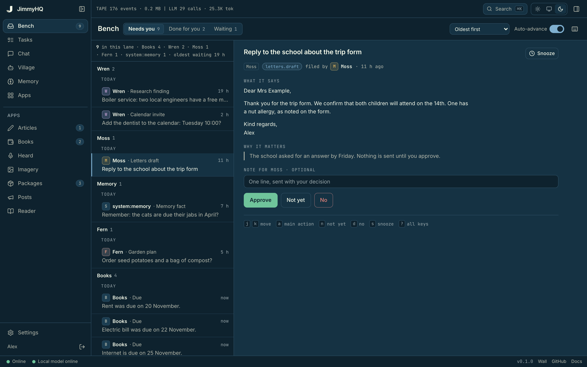
</p>

The theme follows your system, or you choose light or dark under Settings, Appearance.

<p align="center">
  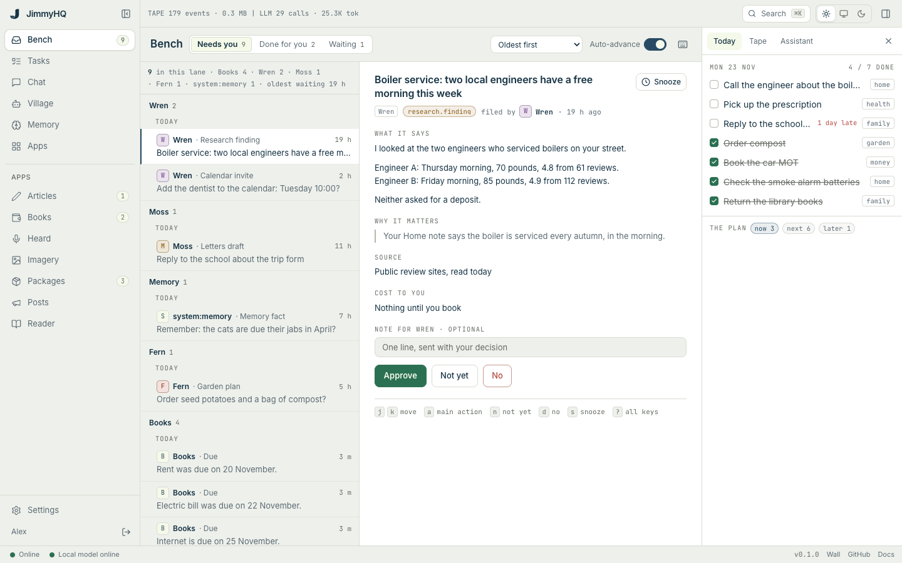
  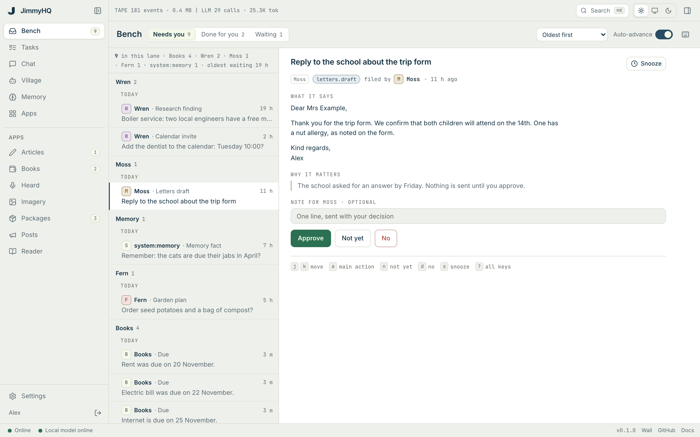
</p>

More: [Bench](docs/bench.md).

### Tasks

One list for your work and your agents' work, with a Today sheet in the side panel. Tasks can
repeat (daily, weekly, monthly, by weekday and more), be pushed to another day, and are marked
stalled after you have pushed them a number of times you choose. There is a list and a board.

<p align="center">
  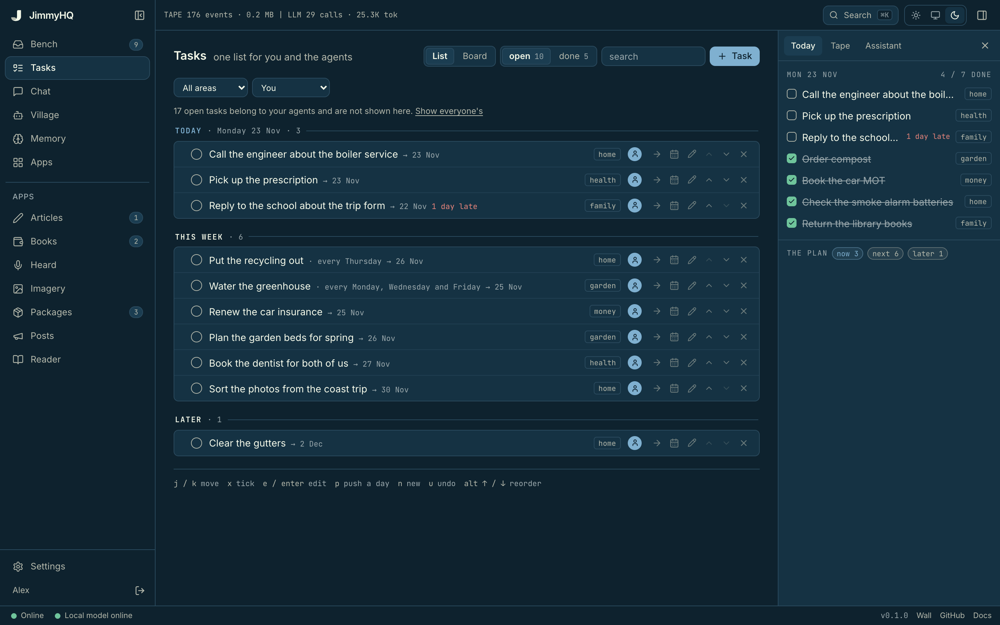
</p>

More: [Tasks](docs/tasks.md).

### Chat and the assistant

Talk to any model you have set up. A conversation can be **on the record** (messages are on the
Tape until you delete the conversation for good) or **off the record** (kept in a separate
file, never on the Tape, with a real delete). Each conversation has switches for **local
only**, **use memory** and **web**, and you can dictate a message. Web lookup is off on a new
install.

<p align="center">
  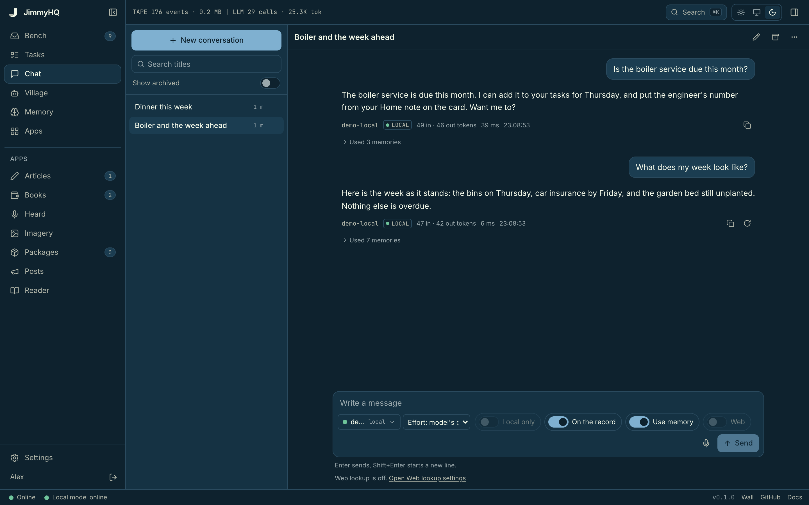
</p>

Chat is for your models. Talking to an agent happens on its own page in the Village. The side
panel has an Assistant tab, but it is a placeholder today. More: [Chat](docs/chat.md).

### The Village

Agents that have a body: energy, frustration, company, curiosity and purpose rise and fall with
what they do and decide what they do next, so an agent paces itself, stops pushing at
something that is not working, and ends its day. Each has a heartbeat, sleep, a diary and
memory that is sorted overnight. You set priorities, talk to any agent, and see which are
waiting on you. An agent can use only the capabilities you switch on for it: web lookup,
integrations, a browser of its own, answering outside messages. All are off until you do.

<p align="center">
  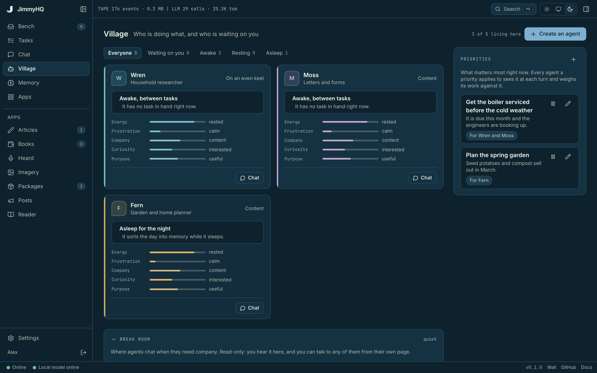
</p>

More: [The Village](docs/village.md), [Web lookup](docs/lookup.md),
[the browser](docs/browser.md), [Integrations](docs/hands.md).

### Memory

What JimmyHQ knows about you, as plain Markdown notes you can read, edit and search with any
editor, plus facts (each says who saved it, how sure it is and from where). Facts can be mined
from the sources you allow, with confidence thresholds, and you can see what was and was not
saved and decline anything. Private history lives in its own store with a real delete. The
index can be thrown away and rebuilt from the files.

<p align="center">
  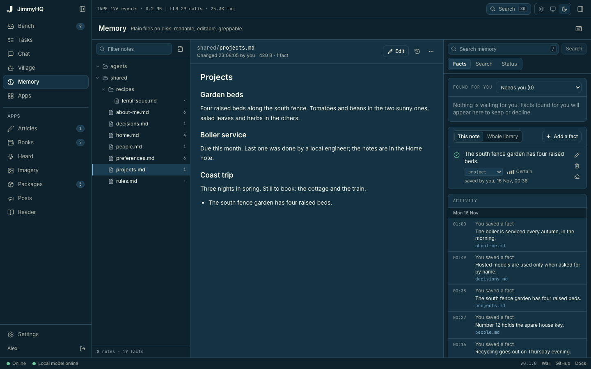
</p>

More: [Memory](docs/memory.md).

### Models

JimmyHQ talks to a model on your machine, a model on another machine you own, or a hosted
model with your own key. Provider types are OpenAI-compatible (which covers most local
servers), OpenAI, Anthropic, Google and AWS Bedrock. You map **roles** (default, cheap, smart,
code, vision, embeddings) to models, so agents and apps ask for a role and you can swap
models without touching them. A provider you mark as local keeps data at home: **local only**
refuses any other provider, a fallback to a hosted model is shown on the reply, and the top
strip counts calls and tokens and what running locally saved.

<p align="center">
  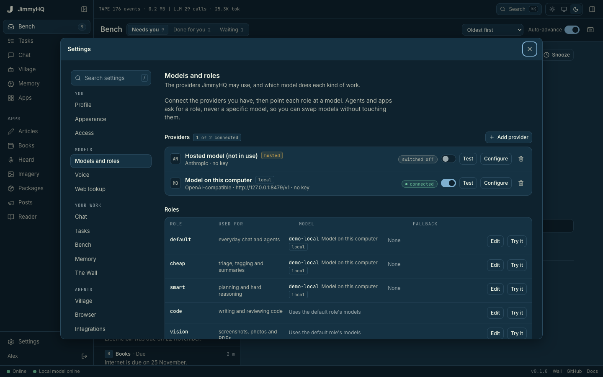
</p>

More: [Models](docs/models.md).

### Voice

Dictation turns your speech into text in Chat and in apps that ask for it. Recognition can run
on your computer (Whisper through the optional `speech` extra, or NVIDIA's Parakeet through
`speech-parakeet`) or go to a speech server you name. No audio or words are kept: only a
receipt on the Tape. A hosted engine receives audio only from the places you list. Spoken
commands and spoken replies are planned, not built.

More: [Speech](docs/speech.md).

### The Wall

A status board for a second screen, at `/wall`: clock, usage, the Bench, today's tasks, model
health and the live Tape. It needs no pointer, never scrolls and fills the screen. It has
settings for the tiles, a 24-hour clock and burn-in protection, and a kiosk recipe.

<p align="center">
  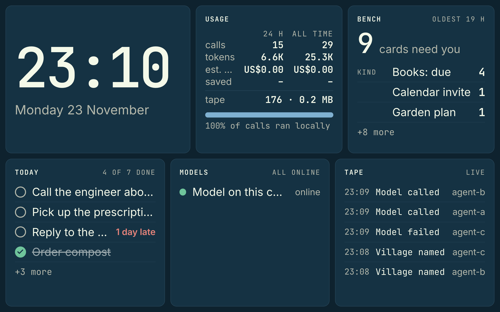
</p>

More: [The Wall](docs/wall.md).

### Backups

Under Settings, Backups you choose a folder outside the data folder (and, if you like, a
second one). JimmyHQ then makes a backup every day by default, copies each database with
SQLite's own backup, keeps the newest seven, checks each one as it is made, and fully tests
the newest every week. A card appears on the Bench if backups stop working. Restoring is done
from a terminal with the program stopped, and never deletes the old data folder: it moves it
aside.

```bash
uv run jimmyhq backup now
uv run jimmyhq backup list
uv run jimmyhq backup verify <backup folder>
uv run jimmyhq backup restore <backup folder>
```

A backup holds your sign-in and your keys for outside services, so keep it where only you can
read it. More: [Back up and move your data](docs/architecture.md#back-up-and-move-your-data).

### Reaching it from other devices and machines

JimmyHQ listens on `127.0.0.1`, so only the computer it runs on can open it. To use it from
your phone or a laptop, put it on a private network you trust. Settings, Access can set up
[Tailscale](https://tailscale.com) Serve for you after showing the exact command. It reaches
only devices on your own tailnet, JimmyHQ never runs Funnel (the public one), and it refuses a
request that arrives through Funnel. Every device still signs in with your password.

<p align="center">
  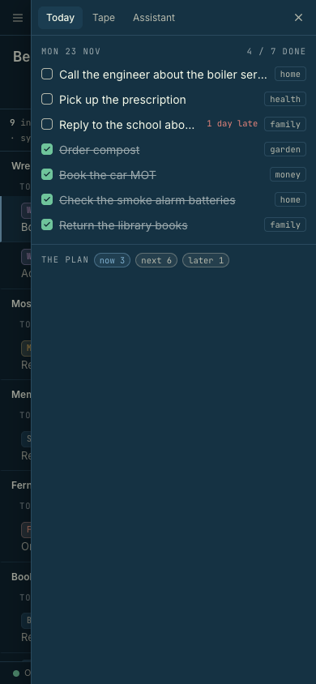
  &nbsp;&nbsp;
  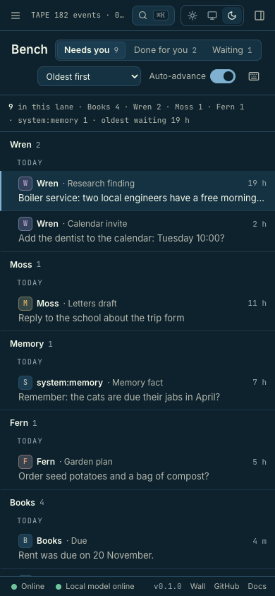
</p>

A second machine of yours, for example one with a graphics card, can join as a **node** and
lend its models to the first. Your agents, the Tape, settings and decisions stay where they
are. Lending models is the only thing a node does today.

More: [Reaching JimmyHQ from your other devices](docs/remote.md), [Nodes](docs/nodes.md).

### The doors

There are two ways in for things that are not you, and both are off until you switch them on.

- **Other AI apps (the MCP door).** An outside assistant can connect over the
  [Model Context Protocol](https://modelcontextprotocol.io) to a small, fixed set of tools. It
  has a port of its own that answers `/mcp` and nothing else. Every client is named by you,
  has its own token and can use no tool until you allow it, with a daily limit for each. What
  it sends is data, never instructions, and every call is recorded. More:
  [The MCP door](docs/door.md).
- **Messages from your devices (the device door).** A full app can take small JSON messages
  from a device on your network, such as a home hub or a recorder, at
  `/api/in/<app>/<name>`. Each message needs a key you make on that app's page. More:
  [Messages from your devices](docs/apps.md#messages-from-your-devices).

## Apps

An app adds a screen, a tile or a skill. Each app lists what it may touch before you install
it, and you can switch it off or remove it at any time. Removing an app keeps its data unless
you say otherwise. These come with JimmyHQ and install by name from the Apps screen, under
"Made by the JimmyHQ project":

<!-- apps-table:start -->
| App | What it does | Tier | Private store | Version |
|---|---|---|---|---|
| **Articles** | Researches a topic, writes an article from its numbered sources, checks every claim against them, and publishes only when you approve. | full | no | 0.2.6 |
| **Books** | Your own bookkeeping: accounts, a register, transfers, bills and income reminders, debts and a payoff order, reconciling, and spending by category. | full | yes | 0.3.4 |
| **Heard** | Keeps what your wearable recorder transcribed as searchable conversations. | full | yes | 0.2.2 |
| **Imagery** | Makes pictures from a description with the image service you choose, keeps them in a gallery you can search, and holds back at a daily limit you set. | full | no | 0.2.3 |
| **Packages** | Keeps your parcels in one place: each one's status and last event, checked for you on a schedule, with a card on your Bench when one arrives or runs into trouble. | full | yes | 0.1.5 |
| **Posts** | Turns articles worth sharing into posts that are checked against their source, and books them only when you approve. | full | no | 0.3.8 |
| **Reader** | Finds articles on the topics you choose, says why each was suggested, and puts them where you want: a reading list, your Bench, your Memory, or other apps. | full | no | 0.3.4 |
<!-- apps-table:end -->

A **private store** means the app keeps what it holds off your record and its cards carry only
a title. The table is generated from each app's manifest (`apps/*/jimmyhq.app.json`). Apps that
send something out start in **Practice**, where they record what they would have done and send
nothing, so you can try each one first. [First steps](docs/first-steps.md) walks through
installing one, and each app has a guide: <!-- apps-guides:start -->[Articles](docs/articles.md), [Books](docs/books.md), [Heard](docs/heard.md), [Imagery](docs/imagery.md), [Packages](docs/packages.md), [Posts](docs/posts.md) and [Reader](docs/reader.md)<!-- apps-guides:end -->.

<p align="center">
  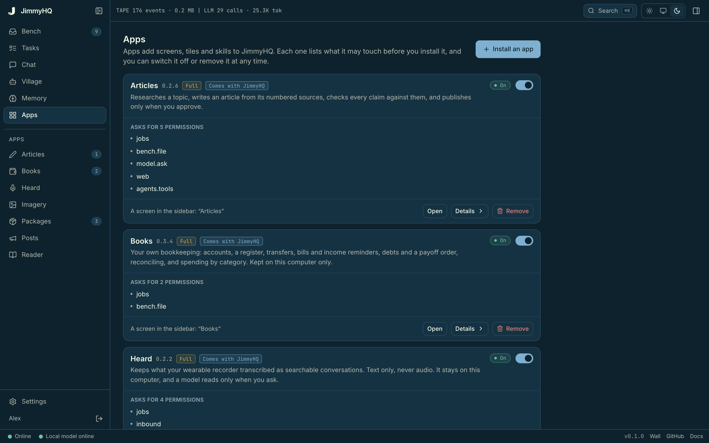
</p>

<p align="center">
  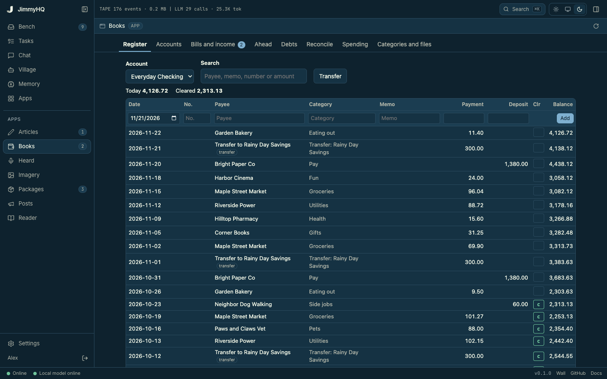
  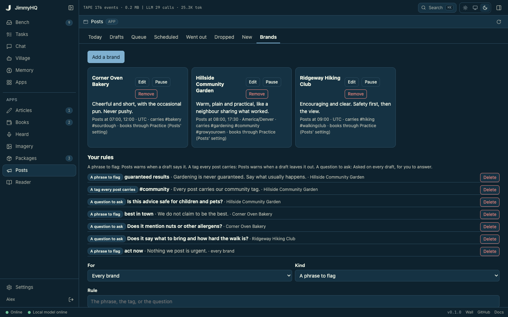
</p>
<p align="center">
  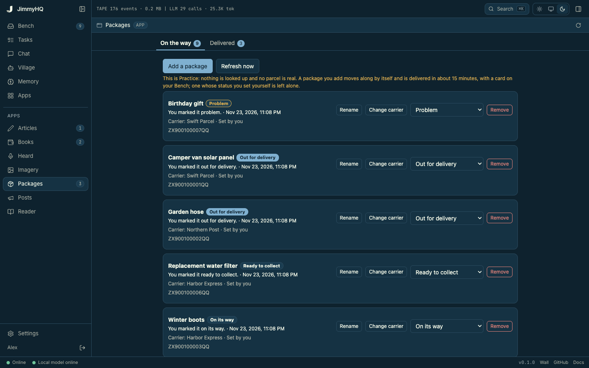
  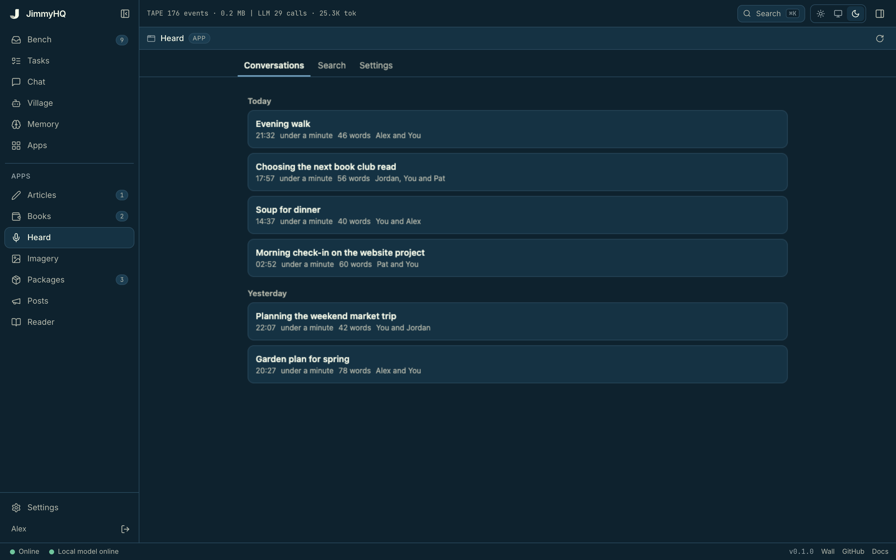
</p>
<p align="center">
  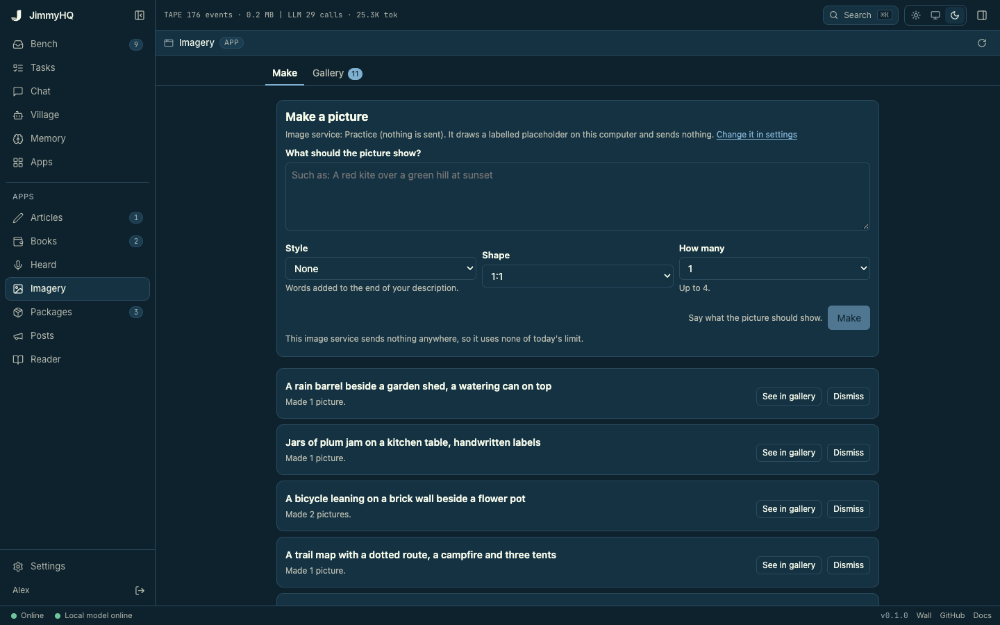
</p>

### How apps are sandboxed and given permission

There are three kinds of app, and the install dialog says which one you are looking at.

| Kind | Is | Can do |
|---|---|---|
| Described | A manifest and nothing else: tables and views | Keep and show records. No code. |
| Sandboxed | A web page in a locked frame | Only what its permissions list, through a bridge. |
| Full | A program that runs as you | Anything you can. JimmyHQ cannot limit it, and the dialog says so. |

A sandboxed page runs in an `<iframe sandbox="allow-scripts allow-forms">` with an opaque
origin: no cookies, no reach into JimmyHQ's page or API, no network of its own. Everything it
does goes through the bridge, which checks the permissions you granted, per-app limits (storage,
requests, model calls, network calls) and which hosts it may talk to. It cannot read the Tape,
change a setting, read another app's data, decide a Bench card, or learn anything about you
beyond your time zone and week start.

A full app is a Python program JimmyHQ starts and restarts. It talks to JimmyHQ over local HTTP
with a token of its own, but it is an ordinary process on your computer: it can read your files
and use the network. Installing one asks you to type its name. **Every app that ships with
JimmyHQ today is a full app**, and there is no store and no review yet, so install an app from
anyone else only if you trust them. You read the permissions, in plain sentences, before you
install, and an update that asks for a new permission always waits for your yes.

More: [Apps](docs/apps.md).

## Quick start

### What you need

- A computer running macOS, Linux or Windows. The server tests run on all three in CI.
- [uv](https://docs.astral.sh/uv/), which installs the right Python (3.12 or later) for you.
- [Node.js](https://nodejs.org) 22 or later, to build the web app once (CI uses 24).
- [git](https://git-scm.com).
- Optional: a Chromium-family browser (Chrome, Chromium, Edge or Brave), only if you want an
  agent to have a browser of its own.
- Optional: a model. Without one the screens work, but nothing can answer. See
  [First steps](docs/first-steps.md).

### Install and run

The commands are the same on every system. On Windows, use PowerShell.

```bash
git clone https://github.com/shaunpoland1/JimmyHQ.git
cd JimmyHQ
uv sync
cd web
npm ci
npm run build
cd ..
uv run jimmyhq run
```

Then open <http://127.0.0.1:8440> and create your owner account (a name and a password).
JimmyHQ starts three processes (the web app, a worker for scheduled jobs and the Village) and
restarts one if it stops. Stop it with Ctrl-C. If the web app was not built, the page says so
and picks it up as soon as it is built.

Optional extras: `uv sync --extra speech` (Whisper), `--extra speech-parakeet` or
`--extra bedrock`. Name every extra you want each time, because `uv sync` removes the ones you
leave out.

To start JimmyHQ at login, run `uv run jimmyhq service install`. It writes the definition for
your system (launchd on macOS, a systemd user service on Linux, a scheduled task on Windows)
and prints the one command that switches it on, which you run yourself. No administrator
rights are needed.

### First run

1. Create the owner account. There is no recovery by email. If you forget the password, run
   `uv run jimmyhq owner set-password` on that computer.
2. Choose a model ([Models](docs/models.md)), then add an app ([First steps](docs/first-steps.md)).
3. Under Settings, Backups, choose a backup folder. Backups are off until you do.

### Where your data lives

In one folder. `uv run jimmyhq data-dir` prints it. Unless you set `JIMMYHQ_DATA`, it is
`~/Library/Application Support/JimmyHQ` on macOS, `~/.local/share/JimmyHQ` on Linux (or under
`XDG_DATA_HOME`) and `%LOCALAPPDATA%\JimmyHQ` on Windows. It is outside the source tree on
purpose, so it cannot be committed by accident. [Architecture](docs/architecture.md#stores)
lists every file in it.

### Updating

```bash
git pull
uv sync
cd web && npm ci && npm run build && cd ..
```

Then restart JimmyHQ. Make a backup first (`uv run jimmyhq backup now`). A store written by an
earlier release is brought up to date, step by step, when JimmyHQ starts. A store written by a
*newer* JimmyHQ is never touched: JimmyHQ refuses to start, names the file and tells you to
update or put back a backup.

### Trying it with sample data

`scripts/demo_data.py` fills a new, empty folder with an invented household, which is how the
pictures in this README were made. It refuses to touch any folder you did not name:

```bash
JIMMYHQ_DATA=/tmp/jimmyhq-demo JIMMYHQ_PORT=8478 uv run python scripts/demo_data.py --serve
```

It takes a few minutes, because each app's sample is entered through the app's own calls.
Then open <http://127.0.0.1:8478> and sign in with the demo owner's password, which is
`DEMO_PASSWORD` in `scripts/_demo_common.py`: it is public and protects nothing. Ctrl-C stops
it, and the same command with `--serve-only` runs the folder again later. The demo includes a
small pretend model that answers from a fixed list, so Chat and the Village have something to
talk to. It runs only while `demo_data.py` or `take_screenshots.py` is running, so run the demo
folder with `--serve-only`, not with `jimmyhq run`. On Windows, set the two variables first
(`$env:JIMMYHQ_DATA = "C:\Temp\jimmyhq-demo"`).

## Configuration

**Settings.** Anything that could differ between two users is a setting, declared once with a
type, default, range, label and help text; the Settings screen is generated from those
declarations. There are several hundred, grouped by area (You, Models, Your work, Agents,
System and one page for each app). Each change is an ordinary event on the Tape, so you can see
who changed what.

**Settings as files.** Every setting can be read and changed from the command line and from a
JSON file, and a file of preferred settings (a profile) can be shared. A profile leaves out
what is personal to you or your computer, and no file ever holds passwords, keys or tokens.

```bash
uv run jimmyhq settings list --changed
uv run jimmyhq settings set appearance.theme dark
uv run jimmyhq settings export --profile --changed -o my-profile.json
uv run jimmyhq settings import profiles/quiet.json --dry-run
```

Example profiles are in [`profiles/`](profiles/README.md).

**Environment variables.** Only the few values needed before the Tape opens are outside the
settings. Each can also be set in `config.toml` in the data folder, under `[server]`, using
the key shown. A variable wins over the file.

| Variable | `config.toml` key | Meaning | Default |
|---|---|---|---|
| `JIMMYHQ_DATA` | | The data folder | See above |
| `JIMMYHQ_HOST` | `host` | The address the web app listens on | `127.0.0.1` |
| `JIMMYHQ_PORT` | `port` | The port | `8440` |
| `JIMMYHQ_ALLOWED_HOSTS` | `allowed_hosts` | Other names this server may be reached by (comma-separated) | none |
| `JIMMYHQ_REMOTE_SETUP` | `remote_setup` | Let the owner account be created from another machine | off |
| `JIMMYHQ_TRUSTED_PROXIES` | `trusted_proxies` | Proxy addresses whose forwarding headers are believed | none |
| `JIMMYHQ_ALLOW_PUBLIC` | `allow_public` | Answer requests Tailscale marks as from the public internet | off |
| `JIMMYHQ_WEB_DIST` | | Serve a web build from this folder | the repo's `web/dist` |

## Security model

What JimmyHQ does:

- It listens on your own machine only unless you say otherwise, and refuses a request addressed
  to a name you have not allowed. A request relayed by a proxy on the same computer is not
  treated as coming from the computer itself.
- There is one owner. The password is stored as an scrypt hash. A browser session is an
  HttpOnly cookie, and only its digest is stored. Five wrong passwords in fifteen minutes
  pause sign-in. Requests from another site's page are refused.
- API tokens are made by the owner and are readers or writers, never the owner: no token can
  change settings, passwords or other tokens. A revoked token stops on its next request. A door
  client's token opens the MCP door only, and a node's token the node link only.
- Keys for outside services are kept in an owner-only file, `secrets.json`, and are never
  written to the Tape or to logs.
- Text from a page, an email or a file is data, never instructions: it cannot trigger an
  action without approval. Where a model picks from evidence, it picks by number.
- Sandboxed apps are held to their permissions (see [Apps](#how-apps-are-sandboxed-and-given-permission)).
  An agent's browser cannot reach your machine, your network or JimmyHQ itself, and cannot type
  into password, card or address fields.

What it does **not** protect against:

- **Anyone who can use your computer account.** The data folder is not encrypted. Whoever can
  read your files can read the Tape, your memory, your keys and your password hash. Use
  full-disk encryption and a screen lock. `jimmyhq owner set-password` asks for no proof
  beyond being at the computer, because anyone who can run it can already read everything.
- **A full app.** It runs as you. JimmyHQ cannot limit it. Apps from other people are
  unreviewed: there is no store and no review yet.
- **A model or service you connect.** What you send to a hosted model, a search provider, a
  speech endpoint or a host you granted an app leaves your computer and is theirs to handle.
- **Plain HTTP on a network.** JimmyHQ does no TLS of its own. Put it behind something that
  does, such as Tailscale Serve, and never expose it to the public internet.
- **Copies you made earlier.** Erasing something does not reach a backup, a snapshot or a
  synced copy made before. Your backups also hold your sign-in and your keys.
- **A mistake in the code.** No independent security review is behind this README. Treat
  JimmyHQ as early software. To report a problem privately, see [SECURITY.md](SECURITY.md).

## Privacy

Nothing is sent to the JimmyHQ project: there is no telemetry, no analytics and no crash
reporting. Nothing leaves your computer unless you set it up to, and these are all the ways it
can:

| What | Leaves when | Goes to |
|---|---|---|
| Prompts, and the memory passages included with them | You use a hosted model, by role or by name. A local model keeps them at home. | The provider you configured |
| Search queries and page requests | You switch on web lookup (off by default) and a conversation or agent uses it | The search provider you chose; the sites you read |
| Audio | You choose a speech server that is not on your network, and list the place that may use it | That server |
| What an app sends | You granted it a host (`net:<host>`) or a hosted model role | That host or provider |
| Actions through an integration | You approve a request, or allow that action to run alone | The integration's service |
| An agent's browser requests | You give that agent a browser | The sites it opens |
| Looking for a newer app version | An app installed from a git address, every 24 hours by default (`apps.update_check_hours`, 0 never) | That address; nothing is fetched or installed by looking |
| Your traffic between devices | You turn on Tailscale access | Your own tailnet |

Each of these has a switch or a setting.

## Architecture in brief

- **Three processes**, started by `jimmyhq run`: the web app and API, a worker for scheduled
  jobs, and the Village (the agents' bodies and loops). They share one data folder.
- **Python core** in `server/jimmyhq/`: FastAPI, SQLite and plain files. Features are modules
  (tasks, bench, models, speech, chat, wall, memory, village, lookup, hands, door, remote, apps,
  browser, nodes, backup), each with its own event kinds, settings, routes and jobs.
- **The Tape** (`tape.db`) is the record. **Lenses** are stored views over it, rebuilt by
  replaying the Tape. Large content goes in a vault named by hash.
- **The web app** in `web/` is React with TypeScript, built once and served by the web
  process. Pure logic is kept apart and tested.
- **Apps** run beside the core and talk to it through the app API.

Start with [Architecture](docs/architecture.md) (processes, every store and whether it can be
rebuilt, the Tape, lenses, settings, access, backups), then the page for each module:
[tasks](docs/tasks.md), [bench](docs/bench.md), [models](docs/models.md),
[speech](docs/speech.md), [chat](docs/chat.md), [wall](docs/wall.md), [memory](docs/memory.md),
[village](docs/village.md), [lookup](docs/lookup.md), [browser](docs/browser.md),
[hands](docs/hands.md), [door](docs/door.md), [remote](docs/remote.md),
[nodes](docs/nodes.md) and [apps](docs/apps.md).

## Building an app

```bash
uv run jimmyhq apps new plant_care               # a working full app: a job, a card type, a screen, a test
uv run jimmyhq apps new plant_care --tier sandboxed
uv run jimmyhq apps dev plant_care               # install it here and put each change in place
uv run jimmyhq apps check plant_care             # the checks it must pass before anyone installs it
```

- [Apps](docs/apps.md) is the full guide: the manifest, permissions, the bridge, hosts and
  secrets, messages from devices, working with agents and feeds between apps.
- The Python SDK for a full app's program is in `sdk/python/jimmyhq_app` (it needs only `httpx`
  and `pydantic`) and has a fake core for tests with no JimmyHQ at all. The JavaScript bridge and
  page helpers a sandboxed or full app's page is given are in `sdk/js`.
- `apps/examples/` has five small apps to read, `watering` first. The apps in `apps/` are
  larger, real examples.
- There is no app store yet. You can install from a folder or an https git address. See
  [Contributing](CONTRIBUTING.md#submitting-an-app).

## Development

```bash
uv sync
cd web && npm ci && cd ..
uv run pytest -n auto          # everything, about 25 seconds on a recent computer
uv run pytest tests/test_tasks*.py   # while working on one module
uv run ruff check
cd web && npm run typecheck && npm test && npm run build
```

- `server/jimmyhq/` is the Python core, `web/` the React app (pure logic in `web/src/lib/`),
  `apps/` the first-party apps (each with its own tests), `sdk/` the app SDKs, `docs/` the
  guides and `tests/` the server tests. Test names are sentences that say what must stay true.
- If you change an event kind, run `uv run python scripts/gen_types.py` to regenerate the
  shared types.
- Use a scratch data folder while developing: `JIMMYHQ_DATA=/tmp/jimmyhq-dev`.
- `tests/test_public_safe.py` keeps names, hosts and addresses of real people out of the repo.
  Everything in tests and sample data is invented.
- [CONTRIBUTING.md](CONTRIBUTING.md) has the design rules every change follows.

### Screenshots

The pictures in `docs/screenshots/` and the apps table above are generated, and tests fail if
they fall out of step. To refresh them, see [Releasing](docs/releasing.md):

```bash
uv run python scripts/readme_tables.py --write    # the apps table and the version
JIMMYHQ_DATA=/tmp/jimmyhq-demo JIMMYHQ_PORT=8478 uv run python scripts/demo_data.py
JIMMYHQ_DATA=/tmp/jimmyhq-demo JIMMYHQ_PORT=8478 uv run python scripts/take_screenshots.py
```

## Project status

JimmyHQ is at version <!-- version:start -->0.1.0<!-- version:end -->, in early development.

- **Solid enough to try:** the Tape, settings, sign-in, the Bench, Tasks, Chat, the Village,
  Memory, models, the Wall, backups with a restore test, and the app platform. The server
  tests run on macOS, Linux and Windows, and the apps have tests of their own.
- **Not yet proven against the real services.** These connections are written from each
  service's published documentation and have not been run against the real service: Posts to
  SocialBu and Buffer, Packages to 17TRACK, Imagery to Gemini and to your own image server,
  Articles to WordPress, and several parts of the integrations (AgentMail, Composio). Each
  app's guide says what could and could not be confirmed. Each starts in Practice. Try one
  real record you can afford to get wrong first.
- **Not built yet:** spoken commands and replies, agents inside Chat, the Assistant tab, an
  app store and review, a desktop app, and more than one user per install.
- **Expect rough edges, and keep backups.** No independent security review has been done.
- The speech engines were measured on one machine and one kind of recording. See
  [Speech](docs/speech.md).

## Roadmap

In short: image making and voice, Chat with agents, an app store with review before public
launch, then a development workspace; later a no-code app builder and agent hiring and
retros; and under consideration a desktop app and more than one user per install. The order,
and what each step means, is in [ROADMAP.md](ROADMAP.md).

## Contributing

Bug reports, ideas and pull requests are welcome. Open an issue first for anything larger than
a small fix. Start with [CONTRIBUTING.md](CONTRIBUTING.md), and note that every commit is
signed off (`git commit -s`). To report a security problem, see [SECURITY.md](SECURITY.md).
Everyone taking part follows the [code of conduct](CODE_OF_CONDUCT.md).

## Licence

JimmyHQ is released under the [Apache License 2.0](LICENSE).
